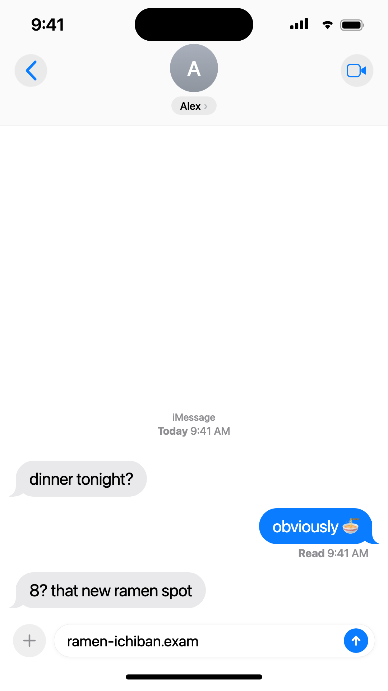
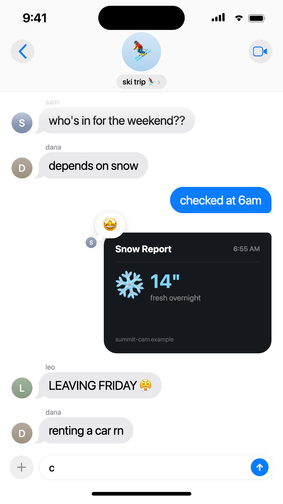

# remotion-imessage

Realistic iMessage conversation videos in [Remotion](https://remotion.dev) — research-tuned cadence, native iOS 26 chrome, typing indicators, tapback reactions, group chats. Write a conversation as data, get a deterministic 1080×1920 video.

<p>
  
  
</p>

## Why this looks real

Every timing constant traces to published research or measured references, not eyeballing:

| Detail | Value | Source |
|---|---|---|
| Reply delay | ~50ms × chars of previous message, clamped 0.6–1.5s | Gnewuch et al., ECIS 2018 / BISE 2022 — dynamic delays increase perceived humanness |
| Typing-indicator duration | ~50ms × chars of the reply, clamped 0.9–2.6s | same; proportionality is what reads as human |
| Input-bar typing | 2 frames/char (≈5× the 36.2 WPM human mobile baseline) | Palin et al., MobileHCI 2019 (37k-person study) |
| Typing indicator anatomy | dot fade 1→0.5 over 0.5s autoreverse, 0.33s/dot stagger, bubble breathe 1→1.04 | measured from nathantannar4/TypingIndicator (best open-source replica) |
| Bubble pop spring | damping 18 / stiffness 190 / mass 1 (ζ≈0.65) | Apple WWDC23 "Animate with springs" — lands in the bounce≈0.2 zone, under Apple's 0.4 ceiling |
| Send blue, chrome, tapbacks | #0A7CFF, glass nav buttons, capsule name chip, white tapback balloon + thought trail + reactor avatar | matched against Apple Support iOS 26 screenshots |

Everything is driven by `useCurrentFrame()` — no CSS animations, fully deterministic renders.

## Quickstart

```bash
git clone https://github.com/nikosmaheras-code/remotion-imessage
cd remotion-imessage
npm install
npm run dev          # Remotion Studio
npm run render -- DemoGroup out/demo.mp4
```

## Write your own conversation

```tsx
import { ChatScreen, createChat } from "./lib/chat";

const SENDERS = {
  me:   { name: "you",  initial: "Y", grad: ["#A9B0BB", "#8E959F"], me: true },
  sam:  { name: "sam",  initial: "S", grad: ["#9BA8C2", "#7E8CA8"] },
  dana: { name: "dana", initial: "D", grad: ["#B4AB9E", "#9A917F"] },
};

const chat = createChat(
  [
    { from: "sam", text: "who's in for the weekend??", lines: 1 },
    { from: "me", text: "checked at 6am", lines: 1 },
    // any JSX renders inside a photo bubble
    { from: "me", image: { content: <MyScreenshot />, height: 460 },
      tapback: { emoji: "🤩", by: "sam" } },
    { from: "dana", text: "renting a car rn", lines: 1, wait: 30 },
  ],
  SENDERS,
  { pace: 1.6 }, // 1 = research-real cadence; higher = faster cut
);

export const MyChat = () => (
  <ChatScreen
    chat={chat}
    title="ski trip ⛷️"
    avatar={{ kind: "group", emoji: "⛷️", tint: ["#D6E8F7", "#AFD2EE"] }}
  />
);

// register with durationInFrames={chat.duration}
```

### Message types

- `text` — bubble with tail, grouped corners, send/receive springs. Sent messages **type out in the input bar** (caret, send button, press pulse) before the bubble whooshes up.
- `image` — photo bubble; pass any ReactNode as `content` (fake screenshots, scoreboards, share cards). Sends with a "picking the photo" pause instead of a typing indicator.
- `linkCard` — iMessage link preview (your content on top, title + domain footer). The `text` field is what gets typed in the input bar before sending.
- `tapback` — native delivered-reaction balloon (white, large emoji, thought-trail dots); in group chats it carries the reactor's mini avatar. The thread pushes apart to make room, like the real relayout.
- `wait` — extra frames of silence before a message (time passing).

### Options

- `createChat(messages, senders, { pace, fps, intro, outro })`
- `<ChatScreen chat title avatar readReceipts receiveSound footnote time />`
  - `readReceipts` — Delivered → **Read** under the latest sent message (1:1 chats)
  - `receiveSound` — optional audio src played on each incoming message (bring your own file; Apple's tritone is not redistributable)
  - group mode (names, avatars, gutter) switches on automatically when more than one non-`me` sender exists

### Gotchas baked in

- `lines` is a manual wrapped-line count — deterministic layout without DOM measurement (~27 chars/line at the default width; ALL-CAPS counts ~1.2×)
- Tall image bubbles are clipped while their slot grows, so they never paint over earlier messages mid-spring
- Slot heights include their gap, so nothing jumps when a slot mounts
- Renders use the system font stack; on macOS that's real SF Pro

## License

MIT. The iMessage visual style belongs to Apple — this is a fan-made reproduction for video creatives; use responsibly.
